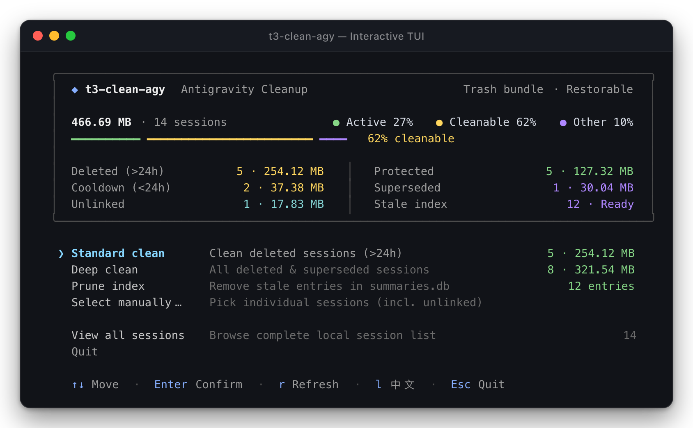
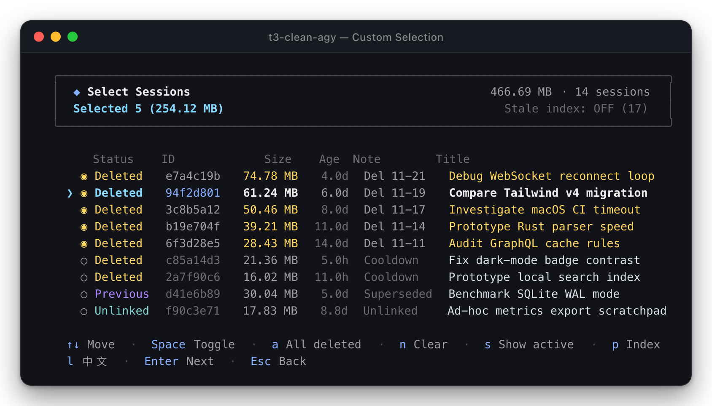

<div align="center">

# t3-clean-agy

**Safely preview, interactively select, and clean orphaned Antigravity local sessions left behind by T3 Code on macOS.**

[](https://github.com/Jerry2003sky/t3-clean-agy/releases)
[](#requirements)
[](#requirements)
[](#requirements)
[](./LICENSE)

[English](./README.md) · [简体中文](./README.zh-CN.md)

<br />



</div>

> **Unofficial community tool** — not affiliated with T3 Code or Google Antigravity. Verified against T3 Code's `statev2.sqlite` schema on macOS 15+. If T3 Code changes its storage schema (e.g. `statev3.sqlite`), the tool **refuses to run** rather than guessing.

---

## Why?

When you delete a conversation in T3 Code, T3 soft-deletes the thread in `statev2.sqlite` and eventually compacts old events, while Antigravity's local session files (`conversations/<uuid>.db`, `brain/<uuid>/`, `annotations/<uuid>.pbtxt`) and `conversation_summaries.db` rows under `~/.t3/userdata/providers/antigravity/` accumulate on disk over time.

`t3-clean-agy` is a **single-file, zero-dependency** Python 3 CLI/TUI designed to inspect and reclaim that space with fail-closed safety guarantees.

## Highlights

- **Single file, zero dependencies** — pure Python 3 standard library + built-in macOS tools (`/usr/bin/trash`, `lsof`, `ps`).
- **Interactive TUI & scriptable CLI** — visual storage breakdown, per-session multi-select picker, live rescan (`r`), and one-key English / 中文 toggle (`l`).
- **Fail-closed safety model** — refuses to run on unknown T3 database schemas, protects active/archived/subagent/in-flight sessions, enforces a 24h cooldown, and re-checks state right before touching disk.
- **One-click reversible Trash bundle** — moves cleaned files into a single dated folder in macOS Trash along with `manifest.json` and a conflict-safe `restore.sh`.
- **Opt-in index pruning** — leaves `conversation_summaries.db` untouched by default; only prunes when explicitly requested while T3 & `agy` are fully closed, after saving a consistent WAL-merged backup + merge-safe `restore.sh` to Trash.

## Quick Install

```bash
mkdir -p ~/.local/bin
curl -fsSL https://raw.githubusercontent.com/Jerry2003sky/t3-clean-agy/main/t3-clean-agy -o ~/.local/bin/t3-clean-agy
chmod +x ~/.local/bin/t3-clean-agy
```

Ensure `~/.local/bin` is in your `$PATH`, then run:

```bash
t3-clean-agy
```

## Usage

### Interactive TUI (default in a terminal)

Running `t3-clean-agy` inside a TTY opens the interactive dashboard, where you can trigger a standard clean, deep clean, index prune, or drop into the per-session selector:

<p align="center">
  
</p>

| Key | Action |
| --- | --- |
| `↑` / `↓` or `j` / `k` | Move cursor |
| `Space` | Toggle session selection (in manual picker) |
| `Enter` | Confirm / open view |
| `r` | Live rescan disk & T3 running status (e.g. right after quitting T3 to prune the index) |
| `l` | Toggle English / 中文 live (saved to `~/.config/t3-clean-agy/config.json`; auto-detected from locale on first run) |
| `Esc` / `q` | Go back / quit |

### CLI Mode

```bash
# Read-only preview
t3-clean-agy -n

# Preview including all active protected sessions
t3-clean-agy -n -v

# Clean deleted sessions older than 24h (moves one bundle to macOS Trash)
t3-clean-agy --apply

# Also prune stale index rows in conversation_summaries.db (requires T3 closed)
t3-clean-agy --apply --prune-summaries

# Override display language for a single run
t3-clean-agy --lang en -n
```

Run `t3-clean-agy --help` for all flags.

## Managed Scope

`t3-clean-agy` only inspects and manages `conversations/`, `brain/`, `annotations/`, and (opt-in) `conversation_summaries.db` inside T3's Antigravity profile directory. Other directories such as `implicit/` are **never touched**.

## Safety Invariants (Fail-Closed)

1. **Schema contract check**: Refuses to run (exit code `2`) if a newer/unknown `statev*.sqlite` exists or any required `orchestration_v2_*` table/column is missing.
2. **Circuit breaker**: Aborts if T3 reports live Antigravity threads and sessions exist on disk, yet zero match the active whitelist.
3. **Wide whitelist, narrow deletion**: Protects active + archived threads, BFS-expanded nested native subagents, in-flight handoffs/transfers/outbox entries, `ANTIGRAVITY_CONVERSATION_ID`, open `lsof` handles, and a 24-hour cooldown window (computed from the later of T3 `deleted_at` and file `mtime`).
4. **TOCTOU re-check**: Re-verifies T3 state, category, `mtime`, cooldown, and open handles right before touching disk.
5. **Restorable Trash bundle & opt-in DB prune**:
   - Standard/Deep clean only moves session files into **one dated folder** in macOS Trash via `/usr/bin/trash`, bundled with `manifest.json` and a non-overwriting UUID-grouped `restore.sh` (rolls back on failure; preserves staging bundle with `restore.sh` if any rollback fails).
   - `conversation_summaries.db` is **never touched by default**. Only when explicitly requested (`Prune index` / `--prune-summaries`) — and only when T3 (`statev2.sqlite`) and `agy` are completely closed and no `.t3-clean-staging` leftover exists — does it verify the single-table/no-trigger/no-FK contract, back up a consistent WAL-merged snapshot (+ merge-safe `restore.sh`) to Trash, then `DELETE` + `VACUUM`.
   - **Index pruning scope**: A row in `conversation_summaries.db` is pruned only if it is not active, has no backing files on disk, **and** satisfies at least one of: (a) marked deleted/superseded in T3 (including recursively expanded subagents of deleted threads), (b) an empty shell row (`step_count = 0` and empty `title`, e.g. T3 `t3-antigravity-setup-*` probe entries), or (c) its session was successfully cleaned during this run.

## Restoring a Cleaned Bundle

Open macOS Trash, drag the `t3-clean-agy-YYYY-MM-DD_HHMMSS` folder out (e.g. to Desktop), and run:

```bash
bash ./t3-clean-agy-YYYY-MM-DD_HHMMSS/restore.sh
```

`restore.sh` moves each session back to its exact original paths and skips an entire UUID group if any target file conflicts.

> **Note**: Restoring a session bundle from Trash restores the session files on disk, but does **not** automatically re-insert rows that were pruned from `conversation_summaries.db`. If you also pruned the index, run `restore.sh` inside the corresponding `t3-clean-agy-summaries-backup-*` folder to merge missing rows back without losing newer rows.

## Requirements

- **macOS 15+ (Sequoia or newer)** with built-in `/usr/bin/trash`, `lsof`, and `ps`
- **Python 3.8+** (standard library only; no `pip` packages)

## Exit Codes

| Code | Meaning |
| --- | --- |
| `0` | Success (or user cancelled cleanly) |
| `1` | Runtime error |
| `2` | Fail-closed safety/schema contract violation |

## Development & Tests

```bash
python3 -m unittest discover -s tests -v
```

All tests run in isolated temporary directories with a stub trash binary and never touch `~/.t3`, `~/.config`, or macOS Trash.

## License

[MIT](./LICENSE)
