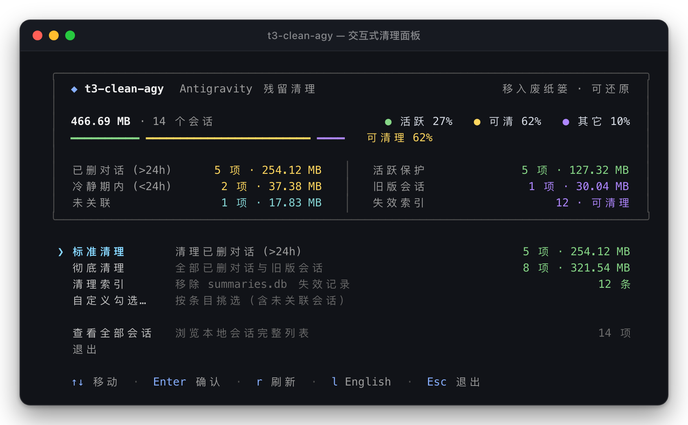

<div align="center">

# T3 Session Cleaner

**安全预览、交互筛选并清理 T3 Code 删除对话后残留在本地的会话数据**（macOS，当前专注 Antigravity）。

[](https://github.com/Jerry2003sky/t3-session-cleaner/releases)
[](#快速开始)
[](#快速开始)
[](#快速开始)
[](./LICENSE)

[English](./README.md) · [简体中文](./README.zh-CN.md)

<br />



</div>

> [!NOTE]
> **非官方社区工具** — 与 T3 Code 及 Google Antigravity 无官方隶属关系。当前基于 T3 Code `statev2.sqlite` 契约验证；若未来出现未知数据库结构（如 `statev3.sqlite`），工具会直接**拒跑保护数据**，绝不猜测误删。

## 快速开始

需 **macOS 15+** 与 **Python 3.8+** — 单文件、零第三方依赖（仅调用系统自带 `/usr/bin/trash`、`lsof`、`ps`）。

```bash
mkdir -p ~/.local/bin
curl -fsSL https://raw.githubusercontent.com/Jerry2003sky/t3-session-cleaner/main/t3-session-cleaner -o ~/.local/bin/t3-session-cleaner
chmod +x ~/.local/bin/t3-session-cleaner
```

确认 `~/.local/bin` 已在 `$PATH` 中，直接运行：

```bash
t3-session-cleaner
```

## 使用方法

### 交互式 TUI

在终端直接执行 `t3-session-cleaner` 即可打开主面板，用于查看空间占比、执行标准/彻底清理、清理失效索引，或逐条勾选会话：

<p align="center">
  
</p>

| 按键 | 功能 |
| --- | --- |
| `↑` / `↓` 或 `j` / `k` | 移动光标 |
| `Space` | 勾选 / 取消会话（自定义选择页） |
| `p` | 开关 `conversation_summaries.db` 索引同步（需 T3 已退出） |
| `Enter` | 确认 / 进入视图 |
| `r` | 原地重新扫描磁盘与 T3 运行状态 |
| `l` | 实时切换中 / 英文界面 |
| `Esc` / `q` | 返回 / 退出 |

### 命令行模式

```bash
t3-session-cleaner -n                         # 只读预览
t3-session-cleaner -n -v                      # 预览并展开全部活跃保护会话
t3-session-cleaner --apply                    # 清理超过 24h 冷静期的已删会话（移入废纸篓）
t3-session-cleaner --apply --prune-summaries  # 同步清理失效索引（需先退出 T3 Code）
t3-session-cleaner --lang zh -n               # 单次指定显示语言
```

完整参数可运行 `t3-session-cleaner --help` 查看。

## 安全机制与还原

- **最小管理范围** — 仅检查和管理 T3 Antigravity 目录下的 `conversations/`、`brain/`、`annotations/` 及（T3 退出时）`conversation_summaries.db`，绝不触碰 `implicit/` 等其他目录。
- **默认保守保护** — 自动保护活跃/已归档对话、嵌套子代理、未完成传输与正在占用的文件，外加默认 **24 小时冷静期**。
- **单包进废纸篓，一键还原** — 每次清理打包为单个时间戳目录移入 macOS 废纸篓，内置 `manifest.json` 与防冲突 `restore.sh`。
- **T3 运行中绝不改库** — 只要 T3 或 `agy` 仍在运行就绝不修改 `conversation_summaries.db`；改库前必先将完整 WAL 合并快照与 `restore.sh` 备份进废纸篓。

### 还原已清理会话

打开 macOS 废纸篓，将 `t3-session-cleaner-YYYY-MM-DD_HHMMSS` 目录拖出（例如拖到桌面），运行：

```bash
bash ./t3-session-cleaner-YYYY-MM-DD_HHMMSS/restore.sh
```

`restore.sh` 会按会话 UUID 整组移回原路径，若目标侧存在冲突则整组跳过、绝不覆盖。

> [!TIP]
> 还原会话文件不会自动恢复已从 `conversation_summaries.db` 移除的索引行。如果当时同时清理过索引，请先完全退出 T3 Code，再运行对应 `t3-session-cleaner-summaries-backup-*` 目录里的 `restore.sh`，它只会增量补回缺失行，不会丢失之后新增的记录。

<details>
<summary><strong>索引详情：5 条 Fail-Closed 安全不变量与索引清理规则</strong></summary>

1. **数据库契约校验** — 发现未知/新版 `statev*.sqlite` 或缺少核心 `orchestration_v2_*` 表/字段时直接拒绝执行（退出码 `2`）。
2. **安全熔断** — 若 T3 存在活跃 Antigravity 线程且磁盘存在会话，但活跃白名单命中数为 0，直接中止防止结构漂移导致误删。
3. **宽白名单 + 窄删除** — 保护活跃及已归档对话、BFS 递归展开的嵌套子代理、未结束的 handoff/transfer/outbox、`ANTIGRAVITY_CONVERSATION_ID`、`lsof` 占用句柄与默认 24 小时冷静期（取 T3 `deleted_at` 与文件 `mtime` 中较晚者）。
4. **动手前实时复检** — 落盘前重新核对 T3 状态、类别变化、文件 `mtime`、冷静期与文件占用，避免竞争条件（TOCTOU）。
5. **单包废纸篓与安全索引同步**：
   - **文件清理**：经系统 `/usr/bin/trash` 打包成单个带时间戳目录移入废纸篓，内含 `manifest.json` 与按 UUID 整组防冲突的 `restore.sh`（失败自动回滚；回滚受阻时保留暂存目录与 `restore.sh`，绝不删原件）。
   - **索引保护**：只要 T3 主进程（`statev2.sqlite`）或 `agy` 仍在运行，或存在 `.t3-clean-staging` 残留，绝不修改 `conversation_summaries.db`。CLI 模式需显式传入 `--prune-summaries`；TUI 清理会话在确认 T3 已完全退出时，默认仅同步删除本次清理会话对应的条目（可按 `p` 关闭，既有失效索引交由「清理索引」单独处理）。执行 `DELETE` 前校验单表/无触发器/无外键契约，并先将完整 WAL 合并备份（含增量 `restore.sh`，且 T3/`agy` 占用任一库时拒绝执行）送入废纸篓。
   - **索引清理条件**：仅清理不活跃、磁盘无对应文件、**且**满足以下之一的索引行：
     - T3 中标记为已删或旧版会话（含已删会话递归展开的子代理）；
     - 空壳行（`step_count = 0` 且 `title` 为空，例如 T3 探测产生的 `t3-antigravity-setup-*` 记录）；
     - 本次运行刚成功清理的会话。

</details>

<details>
<summary><strong>索引详情：相关路径与退出码</strong></summary>

**相关路径**

- 管理数据目录：`~/.t3/userdata/providers/antigravity/`（仅限 `conversations/`、`brain/`、`annotations/`、`conversation_summaries.db`）
- 语言偏好配置：`~/.config/t3-session-cleaner/config.json`（首次运行按系统 locale 自动判断）

**退出码**

| 退出码 | 含义 |
| --- | --- |
| `0` | 执行成功（或用户主动取消） |
| `1` | 运行时错误 |
| `2` | Fail-closed 安全/结构契约校验拦截 |

</details>

## 开发与许可

```bash
python3 -m unittest discover -s tests -v
```

全部测试在隔离临时目录中运行，使用模拟 `trash` 脚本，不会触碰真实 `~/.t3`、`~/.config` 或系统废纸篓。

基于 [MIT 协议](./LICENSE) 开源。
