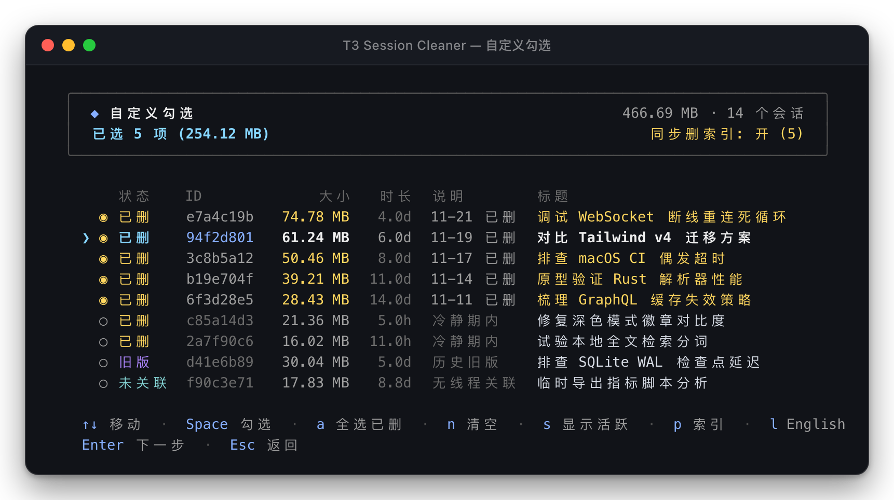

<div align="center">

# t3-clean-agy

**安全预览、交互筛选并清理 T3 Code 删除对话后残留在本地的 Antigravity 会话数据（macOS）。**

[](https://github.com/Jerry2003sky/t3-clean-agy/releases)
[](#运行环境)
[](#运行环境)
[](#运行环境)
[](./LICENSE)

[English](./README.md) · [简体中文](./README.zh-CN.md)

<br />


</div>

> **非官方社区工具** — 与 T3 Code 及 Google Antigravity 无官方隶属关系。当前基于 macOS 15+ 与 T3 Code `statev2.sqlite` 契约验证；如果未来 T3 升级数据库结构（如出现 `statev3.sqlite`），工具会直接**拒跑保护数据**，绝不猜测误删。

---

## 为什么需要它？

在 T3 Code 里删除对话时，T3 仅在 `statev2.sqlite` 中软删除线程记录，而 `~/.t3/userdata/providers/antigravity/` 下的本地会话文件（`conversations/<uuid>.db`、`brain/<uuid>/`、`annotations/<uuid>.pbtxt`）以及 `conversation_summaries.db` 里的索引行会长期残留并持续累积。

`t3-clean-agy` 是一个**单文件、零第三方依赖**的 Python 3 CLI/TUI 工具，专用于以 fail-closed 安全约束回收这部分空间。

## 核心特性

- **单文件、零依赖** — 仅依赖 Python 3 标准库与 macOS 系统内置命令（`/usr/bin/trash`、`lsof`、`ps`）。
- **交互式 TUI + 命令行双模式** — 可视化空间占比条、按会话逐条勾选、清理后自动刷新返回主界面、原地刷新状态（`r`）、一键实时切换中/英文（`l`）。
- **Fail-Closed 安全防护** — 数据库结构升级自动拒跑，默认保护活跃/已归档/子代理/传输中会话与 24h 冷静期，动手前再次实时复检。
- **单包废纸篓、一键无损还原** — 将每次清理的文件打包成单个带时间戳目录移入 macOS 废纸篓，内置 `manifest.json` 与防冲突 `restore.sh`。
- **安全同步索引清理** — 在 TUI 模式下，若 T3 与 `agy` 已完全退出，清理会话时会自动同步删除**仅对应本次清理会话**的 `conversation_summaries.db` 记录（原有失效索引仍交由独立的「清理索引」处理；确认页明确展示并可按 `p` 关闭；T3 运行中自动跳过，CLI 模式仍需显式 `--prune-summaries`），改库前先将完整 WAL 合并备份（含增量合并 `restore.sh`）送入废纸篓。

## 快速安装

```bash
mkdir -p ~/.local/bin
curl -fsSL https://raw.githubusercontent.com/Jerry2003sky/t3-clean-agy/main/t3-clean-agy -o ~/.local/bin/t3-clean-agy
chmod +x ~/.local/bin/t3-clean-agy
```

确认 `~/.local/bin` 已在 `$PATH` 中，直接运行：

```bash
t3-clean-agy
```

## 使用方法

### 交互式 TUI（终端直接运行默认进入）

在终端直接执行 `t3-clean-agy` 即可打开主面板，可执行标准清理、彻底清理、清理索引，或进入自定义逐条勾选视图：

<p align="center">
  
</p>

| 按键 | 功能 |
| --- | --- |
| `↑` / `↓` 或 `j` / `k` | 移动光标 |
| `Space` | 勾选 / 取消会话（自定义勾选视图） |
| `p` | 开关 `conversation_summaries.db` 索引同步清理（自定义勾选与确认页，需 T3 已退出） |
| `Enter` | 确认 / 进入二级视图 |
| `r` | 原地重新扫描磁盘与运行状态（退出 T3 Code 后无需重启工具即可直接清理索引） |
| `l` | 实时切换中 / 英文界面（持久化至 `~/.config/t3-clean-agy/config.json`，首次运行按系统 locale 自动判断） |
| `Esc` / `q` | 返回 / 退出 |

### 命令行模式

```bash
# 只读预览
t3-clean-agy -n

# 展开查看全部活跃保护会话
t3-clean-agy -n -v

# 清理超过 24h 冷静期的已删对话（打包移入 macOS 废纸篓）
t3-clean-agy --apply

# 同步清理 conversation_summaries.db 失效索引（需先退出 T3 Code）
t3-clean-agy --apply --prune-summaries

# 单次指定显示语言
t3-clean-agy --lang zh -n
```

查看完整参数可运行 `t3-clean-agy --help`。

## 管理范围

`t3-clean-agy` 仅检查和管理 T3 的 Antigravity Profile 目录下的 `conversations/`、`brain/`、`annotations/` 以及（可选）`conversation_summaries.db`。诸如 `implicit/` 等其他目录**完全不触碰**。

## 5 条安全不变量（Fail-Closed）

1. **数据库契约校验**：发现未知/新版 `statev*.sqlite` 或缺少核心表/字段时直接拒绝执行（退出码 `2`）。
2. **安全熔断**：若 T3 存在活跃 Antigravity 线程且磁盘存在会话，但活跃白名单命中数为 0，直接中止防止结构漂移导致误删。
3. **宽白名单 + 窄删除**：自动保护活跃及已归档对话、BFS 递归展开的嵌套子代理、未结束的 handoff/transfer/outbox、`ANTIGRAVITY_CONVERSATION_ID`、`lsof` 占用句柄与默认 24 小时冷静期（按 T3 `deleted_at` 与文件 `mtime` 中较晚者计算）。
4. **动手前实时复检**：执行落盘前重新核对 T3 状态、类别变化、文件 `mtime`、冷静期与文件占用，避免竞争条件（TOCTOU）。
5. **单包废纸篓可还原 & 安全的索引同步**：
   - 文件清理通过系统自带 `/usr/bin/trash` 将本次清理打包成**单个带时间戳目录**移入废纸篓，内含 `manifest.json` 与按 UUID 整组防冲突的还原脚本 `restore.sh`（失败自动回滚；若回滚受阻则保留暂存目录与 `restore.sh` 绝不删原件）。
   - **T3 运行中绝不修改 `conversation_summaries.db`**。CLI 模式（`--apply`）下仍需显式传入 `--prune-summaries`；交互式 TUI 下，仅当确认 T3 主进程（`statev2.sqlite`）与 `agy` 均已完全退出且无 `.t3-clean-staging` 残留时，清理会话才默认同步删除**本次清理会话对应**的索引条目（不越权触碰既有失效索引，确认页清晰展示并可按 `p` 随时关闭；既有失效索引统一交给「清理索引」）。改库前必先校验单表/无触发器/无外键契约、将完整 WAL 合并快照（含不丢失新增行的 `restore.sh`）备份进废纸篓后再执行 `DELETE` + `VACUUM`。
   - **索引清理规则**：仅清理不活跃、磁盘无对应文件、**且**满足以下之一的索引行：（a）T3 中已删或旧版会话（含已删会话递归展开的子代理）；（b）空壳行（`step_count = 0` 且 `title` 为空，例如 T3 探测产生的 `t3-antigravity-setup-*` 记录）；（c）本次运行刚成功清理的会话。

## 还原已清理会话

打开 macOS 废纸篓，将 `t3-clean-agy-YYYY-MM-DD_HHMMSS` 目录拖出（例如拖到桌面），运行：

```bash
bash ./t3-clean-agy-YYYY-MM-DD_HHMMSS/restore.sh
```

`restore.sh` 会按会话 UUID 整组将文件移回原路径，若目标侧存在同名或同 UUID 冲突则整组跳过、绝不覆盖。

> **注意**：从废纸篓还原会话文件不会自动恢复已被清理的 `conversation_summaries.db` 索引行。如果之前同时清理过索引，请另行运行对应 `t3-clean-agy-summaries-backup-*` 备份目录里的 `restore.sh`，它只会把缺失行补回当前库，不会丢失之后新增的记录。

## 运行环境

- **macOS 15+ (Sequoia 及以上)**（使用系统内置 `/usr/bin/trash`、`lsof`、`ps`）
- **Python 3.8+**（纯标准库，无需安装任何依赖）

## 退出码

| 退出码 | 含义 |
| --- | --- |
| `0` | 执行成功（或用户主动取消） |
| `1` | 运行时错误 |
| `2` | Fail-closed 安全/结构契约校验拦截 |

## 开发与测试

```bash
python3 -m unittest discover -s tests -v
```

全部测试在隔离临时目录中运行，使用模拟 `trash` 脚本，不会触碰真实 `~/.t3`、`~/.config` 或系统废纸篓。

## 开源协议

[MIT](./LICENSE)
